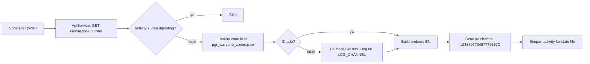

# PRD: Warzone Predict (CN Server) – Auto Post to Discord

| | |
|---|---|
| **Status** | Draft v1 |
| **Owner** | Agus Bot |
| **Target channel** | `1238807704877793372` |
| **Timezone** | WIB (`Asia/Jakarta`, UTC+7) |
| **Message language** | English |

---

## 1. Background & Goal

Server **CN** menerima konten Warzone lebih awal daripada server **AP** (saat ini CN ada di activity ±594, AP di ±465). Zone yang tampil di CN hari ini adalah **prediksi** zone yang akan muncul di AP nanti.

Masalahnya, response CN (`api.huaxu.app/servers/cn/warzone/current`) berisi teks **Mandarin**. Zone ID-nya sama dengan ID di AP, jadi teks bisa diterjemahkan dengan **lookup ke dataset hasil scraping AP** (`data/pgr_warzone_zones.json`, sudah ada, 90 zone ID unik).

**Goal:** bot otomatis mengirim pesan "Warzone Predict" berbahasa Inggris ke channel tertentu pada jam yang dikonfigurasi (WIB), tanpa perlu ada yang menjalankan command manual.

### Non-goals
- Tidak menampilkan leaderboard/ranking, skor, atau weather.
- Tidak menggantikan command warzone yang sudah ada (`wz_embed` / `warzone_service.get_wz_map`).
- Tidak memprediksi server selain AP.

---

## 2. User Stories

1. Sebagai member channel, saya mau melihat zone Warzone yang akan datang di AP dalam bahasa Inggris, otomatis, tiap minggu.
2. Sebagai admin, saya mau mengatur jam kirim (WIB) lewat konfigurasi tanpa mengubah kode.
3. Sebagai admin, saya mau tahu bila ada zone ID baru yang belum ada di dataset terjemahan.

---

## 3. Functional Requirements

### FR-1 Fetch data CN
- Endpoint: `GET {HUAXU_BASE_URL}cn/warzone/current` (tanpa `/16`).
  - Response ±1,5 KB tanpa `rankings`, vs ±214 KB bila memakai `/16`. `area.zones` tetap lengkap.
- Tambahkan method baru di `ApiService`, misalnya `warzone_current_zones(server)`. Method lama `warzone_week` (hardcode `/16`) **tidak diubah**.
- Field yang dipakai: `data.warzone.start`, `data.warzone.end`, `data.warzone.activity`, `data.warzone.area.zones[]` (hanya `id`).
- Retry maksimal 3x dengan backoff bila gagal (timeout/5xx).

### FR-2 Translate via dataset
- Load `data/pgr_warzone_zones.json` sekali saat startup, gunakan `by_id[str(zone_id)]`.
- Per zone ambil dari dataset (**bukan** dari response CN):
  - `name`
  - `description`
  - `buffs[]` (`name` dan `description`)
- **Fallback bila ID tidak ada di dataset** (zone baru yang belum rilis di AP):
  - Tampilkan teks dari response CN apa adanya, dengan label `⚠ Untranslated (CN text)`.
  - Kirim log ke `LOG_CHANNEL_ID` berisi daftar ID yang hilang, agar dataset bisa di-scrape ulang.

### FR-3 Format pesan
Satu pesan berisi 1 teks header + 1 embed per zone (maks. 3 zone).

**Header:**
```
Warzone Predict Cycle 26 Oct 2026 ~ 1 Nov 2026
```
- Tanggal = **Senin** s.d. **Minggu** dari cycle tersebut, format `DD Mon YYYY`.
- Diturunkan dari `start` dan `end` di response, dikonversi ke **WIB**.
  Contoh: `start=2026-10-25T21:00Z` → Senin 26 Okt 04:00 WIB. `end=2026-11-01T10:00Z` → Minggu 1 Nov 17:00 WIB.
- Karena `start` UTC bisa jatuh di hari Minggu, tanggal Senin harus dihitung **setelah konversi ke WIB**, bukan dari tanggal UTC.

**Per zone (embed):**

| Elemen | Sumber | Aturan |
|---|---|---|
| Title | `name` | Nama zone |
| Description line | `description` | Deskripsi zone |
| Buff | `buffs[].description` | Lihat aturan di bawah |

**Aturan buff:**
- Zone dengan **1 buff** → tampilkan `description` buff tersebut.
- Zone dengan **2 buff** (tipikal *Entropic Distortion*) → **gabung jadi satu bagian** berlabel `Buff A` dan `Buff B`.
- Bila jumlah buff > 2, tetap dilabel berurutan (`Buff A`, `Buff B`, `Buff C`).

**Contoh output (zone Entropic Distortion, ID 89):**
```
Entropic Distortion
Duo Challenge: Only 2 Elite enemies spawn per wave

Buff A: Dark DMG greatly increases, Darkflow DMG slightly increases.
Buff B: Fire DMG slightly increases, Ignition DMG greatly increases.
```

**Contoh output (zone 1 buff, ID 1):**
```
Machine Factory
Joint Operation: Refresh multiple Normal and Elite enemies

Buff: Physical DMG greatly increases, Ultima Slash DMG slightly increases.
```

> Catatan: nama buff (`buffs[].name`) tidak ditampilkan, hanya `description`, sesuai permintaan. Untuk Buff A/B, label `A`/`B` menggantikan nama buff.

### FR-4 Scheduler (WIB)
- Implementasi dengan `discord.ext.tasks.loop(time=datetime.time(hour, minute, tzinfo=ZoneInfo("Asia/Jakarta")))`.
- Dimulai di `on_ready` (bagian `twitter_task.start` yang dikomentari menunjukkan pola ini sudah dipakai).
- Konfigurasi lewat `.env` / `config.py`:

| Env var | Contoh | Keterangan |
|---|---|---|
| `WZ_PREDICT_CHANNEL_ID` | `1238807704877793372` | Channel tujuan |
| `WZ_PREDICT_TIME_WIB` | `10:00` | Jam kirim, format `HH:MM` WIB |
| `WZ_PREDICT_DAYS` | `mon` | Hari kirim (lihat Open Question #1) |
| `WZ_PREDICT_ENABLED` | `true` | Toggle fitur |

### FR-5 Idempotency (anti dobel kirim)
- Simpan `activity` CN terakhir yang sudah diposting di file state (misal `services/wz_predict_state.json`).
- Bila `activity` sama dengan yang tersimpan, **skip** (menghindari dobel pada restart bot / scheduler jalan 2x).
- Bila response CN belum berganti cycle pada jam kirim, skip dan retry berkala (lihat NFR).

### FR-6 Command manual (opsional, direkomendasikan)
- `wzpredict` (hybrid command, admin only memakai `admin_permission`) untuk memicu pengiriman manual / preview ke channel tempat command dipanggil. Berguna untuk test tanpa menunggu jadwal.

---

## 4. Non-Functional Requirements

- **Reliability:** bila fetch gagal setelah retry, kirim log error ke `LOG_CHANNEL_ID`, jangan kirim pesan setengah jadi ke channel publik.
- **Discord limits:** embed description ≤ 4096 karakter, total embed per pesan ≤ 6000 karakter. Dengan 3 zone, aman.
- **Pesan 100% bahasa Inggris**, termasuk header, label, dan pesan fallback.
- **Dataset freshness:** dataset hasil `scrape_zones.py` bersifat statis. Perlu re-scrape berkala (lihat Risks).

---

## 5. Technical Design (ringkas)



**File yang disentuh:**
| File | Perubahan |
|---|---|
| `services/api_service.py` | + `warzone_current_zones(server)` |
| `services/wz_predict_service.py` (baru) | Load dataset, translate, build message, state handling |
| `utils.py` | + `wz_predict_embeds(...)` (builder embed) |
| `bot.py` | + task loop, start di `on_ready`, + command manual |
| `config.py` / `.env.example` | + env var di atas |
| `data/pgr_warzone_zones.json` | Sudah ada (output `scrape_zones.py`) |

**Catatan implementasi:** nilai `element` di dataset semuanya `physical` (tidak informatif), jadi **jangan** dipakai untuk logika atau tampilan.

---

## 6. Acceptance Criteria

1. Pada jam yang dikonfigurasi (WIB), pesan terkirim otomatis ke channel `1238807704877793372`.
2. Header memuat tanggal Senin ~ Minggu yang benar dalam WIB.
3. Setiap zone menampilkan nama, deskripsi, dan deskripsi buff dalam bahasa Inggris.
4. Zone dengan 2 buff tampil sebagai satu bagian `Buff A` / `Buff B`.
5. Tidak ada teks Mandarin pada pesan bila semua zone ID ada di dataset.
6. Restart bot pada hari yang sama tidak menghasilkan pesan dobel.
7. Zone ID yang tidak ada di dataset tidak membuat job crash; muncul fallback dan log ke admin.
8. Fetch gagal → tidak ada pesan rusak di channel; error tercatat di log channel.

---

## 7. Risks & Mitigations

| Risk | Dampak | Mitigasi |
|---|---|---|
| CN punya zone ID baru yang belum ada di data AP | Teks tidak ter-translate | Fallback + log; re-scrape saat AP rilis. Pertimbangkan scrape ulang otomatis bila ada ID hilang. |
| Deskripsi zone/buff di AP berubah dari waktu ke waktu | Dataset basi | Dataset menyimpan versi pertama yang ditemui; re-scrape berkala, atau simpan versi terbaru (activity tertinggi). |
| Cycle CN belum berganti saat jam kirim | Pesan berisi cycle lama | Dedupe via `activity` + retry hingga cycle baru terdeteksi. |
| Aturan jumlah zone per cycle berbeda (2 vs 3) | Layout | Builder dinamis berdasarkan jumlah zone di response (sudah terlihat 2 atau 3). |
| Pesan "predict" belum tentu akurat untuk AP | Ekspektasi pengguna | Tampilkan label "Predict" di header (sesuai permintaan). |

---

## 8. Open Questions (perlu keputusan)

1. **Frekuensi & hari kirim:** cycle berganti mingguan. Apakah kirim **sekali seminggu** (hari apa, jam berapa WIB?) atau **setiap hari** di jam yang sama (dengan dedupe agar hanya cycle baru yang dikirim)?
2. **Rentang tanggal di header:** memakai tanggal cycle **CN** (Senin-Minggu CN saat ini), atau tanggal perkiraan kapan zone tersebut muncul di **AP** (butuh asumsi selisih activity CN ↔ AP)? Default PRD ini: **tanggal cycle CN dalam WIB**.
3. **Jam kirim (WIB)** dan **hari** yang diinginkan (nilai default sementara: `10:00`).
4. **Mention role** (mis. `@role`) saat pesan dikirim? Default: tidak ada.
5. **Re-scrape dataset:** cukup manual (`python scrape_zones.py`), atau mau dijadwalkan otomatis?

---

## 9. Out of Scope / Future

- Prediksi untuk server KR/JP.
- Menampilkan weather per zone.
- Tombol/interaksi (pilih server, pilih cycle).
- Multi-channel / multi-guild broadcast.
