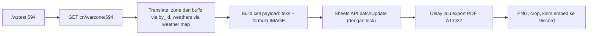

# PRD: Warzone Sheet Updater + Test Command (`/wztest`)

| | |
|---|---|
| **Status** | Draft v1 (tahap uji coba) |
| **Depends on** | [PRD-warzone-predict.md](PRD-warzone-predict.md), `data/pgr_warzone_zones.json`, `/team` renderer |
| **Target sheet** | Spreadsheet `1z_L4MEGv5q89OFkuN2RNI1gjajddD3_NG169_f0RNrA`, `gid=501567643` |
| **Render area** | `A1:O22` |
| **Language output** | English |

---

## 1. Goal

Mengisi sheet "War Zone" secara otomatis dari data Warzone sebuah activity, lalu merender area `A1:O22` menjadi gambar (cara yang sama dengan `/team`) dan mengirimnya ke Discord.

Tahap ini hanya **uji coba lewat command**. Penjadwalan otomatis jam tertentu dan integrasi ke pesan predict ada di tahap berikutnya (section 10).

**Success looks like:** `/wztest 594` → sheet terisi sesuai activity 594 → bot membalas gambar `A1:O22` yang isinya sama dengan tabel di sheet.

---

## 2. Temuan penting dari screenshot (perlu konfirmasi)

Screenshot sheet dicocokkan dengan response API CN (zone ID 89). Hasilnya, istilah di mapping kamu **berbeda** dengan nama field API:

| Kolom di sheet | Isi di screenshot | Field API sebenarnya |
|---|---|---|
| **Environment** (D:G) | `Machine Factory`, `Shadow Forest`, `Molten Chasm` + deskripsi | `zone.buffs[i].name` + `zone.buffs[i].description` |
| **Buff** (H:K) | `Rending Edge`, `Nightbound Engraving`, `Flame Resurged` + deskripsi | `zone.weathers[i].name` + `zone.weathers[i].description` |
| **Enemies** (L:N) | `Duo Challenge: ...` | `zone.description` |

Konsekuensinya:
1. Kolom **Buff** di sheet sebenarnya berisi **weather**, bukan `buffs` dari API. Karena itu `buff.name` / `buff.description` di mapping kamu dibaca sebagai `weathers[i].name` / `weathers[i].description`.
2. Untuk zone 3 (Entropic Distortion, ID 89), nama yang tampil adalah **nama buff** (`Shadow Forest`, `Molten Chasm`), bukan `zone.name` (`Entropic Distortion`). Jadi "zone name" baris 5-6 sampai 17-18 = `buffs[i].name`.
3. Bagian 1 dan 2 zone 3 memakai pasangan yang sama dengan indeks: bagian 1 → `buffs[0]` + `weathers[0]`; bagian 2 → `buffs[1]` + `weathers[1]`.
4. Untuk zone 1 dan 2 (1 buff), `buffs[0].name == zone.name` dan `buffs[0].description == zone.buffDescription`, jadi hasilnya sama dengan mapping kamu.

> **Perlu konfirmasi:** apakah asumsi ini benar (Environment = `buffs`, Buff = `weathers`)? Semua bagian di bawah memakai asumsi ini.

---

## 3. Mapping sel

Semua blok adalah merged range. Nilai ditulis ke **sel kiri-atas** tiap blok.

### Zone 1 (zone index 0, 1 bagian)
| Isi | Range | Sumber |
|---|---|---|
| Logo | `C5:C8` | logo dari `buffs[0].id` |
| Environment name | `D5:G6` | `buffs[0].name` |
| Environment description | `D7:G8` | `buffs[0].description` |
| Buff name | `H5:K6` | `weathers[0].name` |
| Buff description | `H7:K8` | `weathers[0].description` |
| Enemies | `L5:N8` | `zone.description` |

### Zone 2 (zone index 1, 1 bagian)
Sama dengan zone 1, digeser +4 baris: `C9:C12`, `D9:G10`, `D11:G12`, `H9:K10`, `H11:K12`, `L9:N12`.

### Zone 3 (zone index 2, hingga 2 bagian)
| Isi | Bagian 1 | Bagian 2 |
|---|---|---|
| Logo | `C13:C16` | `C17:C20` |
| Environment name | `D13:G14` | `D17:G18` |
| Environment description | `D15:G16` | `D19:G20` |
| Buff name | `H13:K14` | `H17:K18` |
| Buff description | `H15:K16` | `H19:K20` |
| Enemies (satu blok gabungan) | `L13:N20` | |

### Koreksi dari mapping awal (mohon dicek)
| Di request | Dipakai di PRD | Alasan |
|---|---|---|
| Zone 3 bagian 2 `buffdescription D17:G20` | `D19:G20` | Tumpang tindih dengan zone name `D17:G18`; pola bagian 1 adalah 2 baris name + 2 baris description. |
| Zone 3 `description L9:N12` (di bagian 1 dan 2) | dihapus | Itu range zone 2. Deskripsi zone 3 sudah ada di `L13:N20`. |
| `Vortex Barier` | `Vortex Barrier` | Typo. Nama tidak dipakai sebagai key (lihat section 4). |

---

## 4. Mapping logo

URL gambar dari kamu tepat berjumlah **12**, sama dengan jumlah buff unik di dataset (`buffs[].id`). Maka key logo adalah **buff ID**, bukan teks nama (nama buff bisa berubah antar versi, contoh ID 4003 tercatat `Cycle of Fire` dan `Loop of Fire`).

| Buff ID | Nama | URL |
|---|---|---|
| 4001 | Machine Factory | `https://i.imgur.com/oZndftb.png` |
| 4003 | Cycle of Fire | `https://i.imgur.com/EpAS7MM.png` |
| 4004 | Laser Alloy | `https://i.imgur.com/laLaiH4.png` |
| 4005 | Shadow Forest | `https://i.imgur.com/yxvQiJK.png` |
| 4002 | Crimson Frostland | `https://i.imgur.com/oI4Hzmy.png` |
| 4132 | Nihil Floating Platform | `https://i.imgur.com/FV9u72T.png` |
| 4161 | Molten Chasm | `https://i.imgur.com/ZwAUr4Y.png` |
| 4115 | Shattered Peak | `https://i.imgur.com/8tbEI5V.png` |
| 4175 | Shadowed Rift | `https://i.imgur.com/AwP5E4y.png` |
| 4088 | Diffraction Void | `https://i.imgur.com/y5xlPe2.png` |
| 4143 | Gelid Tower | `https://i.imgur.com/LdXeuYs.png` |
| 4114 | Vortex Barrier | `https://i.imgur.com/zHvk2Lo.png` |

- Disimpan di file konfigurasi `data/wz_logo_map.json` (`{"4001": "https://..."}`), bukan hardcode di kode.
- Logo ditulis sebagai formula `=IMAGE("url", 1)` di sel kiri-atas blok logo (mode 1 = fit to cell).
- Buff ID tidak ada di map → sel logo dikosongkan dan dicatat di log.

---

## 5. Functional Requirements

### FR-1 Command test
- `/wztest <activity> [server]`, juga tersedia sebagai prefix command.
- `activity`: angka setelah `warzone/` di URL API (contoh `594` untuk `.../warzone/594`), atau kata `current`.
- `server`: default `cn`. Hanya `cn`/`ap` untuk uji coba.
- **Admin only** (`admin_permission`) selama tahap uji coba, karena command menulis ke sheet bersama.
- Validasi: activity bukan angka/`current` → pesan error bahasa Inggris. Activity di luar rentang (API balas 404 dan menyertakan `activities.min/max`) → tampilkan rentang valid.

### FR-2 Ambil data
- `GET {HUAXU_BASE_URL}{server}/warzone/{activity}` (tanpa `/16`, response ±1,5 KB, `area.zones` tetap lengkap).
- Method baru `warzone_current` di `ApiService` sudah ada dan dipakai ulang.

### FR-3 Terjemahan ke Inggris
Response CN berbahasa Mandarin. Terjemahan memakai dataset hasil scraping AP:

| Data | Sumber terjemahan | Catatan |
|---|---|---|
| `zone.description`, `buffs[]` (name, description) | `by_id[zone.id]` di `pgr_warzone_zones.json` | Sama seperti fitur predict. |
| `weathers[]` (name, description) | **Tidak bisa lewat zone ID** | Lihat di bawah. |

**Masalah weather:** weather berubah tiap cycle dan tidak punya ID. Di dataset, satu zone ID punya 8-13 weather berbeda, jadi tidak bisa menebak weather yang aktif dari zone ID. Dari 48 nama weather di dataset, pasangan `(icon, background)` juga ambigu (9 dari 30 key dipakai >1 weather), jadi tidak aman dijadikan key tunggal.

Rancangan:
1. Bangun `data/wz_weather_map.json` yang memetakan weather CN → Inggris.
2. Cara membangun: scrape cycle CN dan AP lalu cocokkan weather dengan key `(icon, background, angka-angka di deskripsi)`. Pasangan yang hasilnya tidak unik ditandai dan dicek manual.
3. Saat command berjalan: weather CN dicari di map. Tidak ketemu → tampilkan teks CN apa adanya (konsisten dengan permintaan sebelumnya) dan kirim peringatan ke log channel.

> Ini bagian paling berisiko di PRD ini (lihat section 8). Weather yang baru ada di CN dan belum pernah muncul di AP otomatis akan tampil dalam bahasa Mandarin sampai map diperbarui.

### FR-4 Tulis ke sheet
- Gunakan **Google Sheets API** (service account), satu `batchUpdate` per command agar hemat kuota dan atomik.
- Teks ditulis sebagai nilai biasa. Logo ditulis sebagai formula (`USER_ENTERED`).
- **Zone kurang dari 3, atau zone 3 hanya 1 buff:** blok yang tidak dipakai **dikosongkan** (termasuk `L13:N20` bila zone 3 tidak ada, dan bagian 2 zone 3 bila hanya 1 buff), supaya data cycle sebelumnya tidak tersisa. Data historis menunjukkan ada cycle dengan 2 zone.
- Jumlah weather lebih sedikit dari jumlah buff → sel buff terkait dikosongkan, bukan diisi data salah.
- Sel di luar mapping (kolom A, B angka romawi, header) tidak disentuh.

### FR-5 Render dan kirim gambar
- Render `A1:O22` dengan logika `_render_area` yang sudah ada di `TeamService` (export PDF → PNG → crop whitespace).
- Refactor kecil: `_render_area` saat ini terkunci ke `teamImageSpreadsheetId` dan `teamSheetGid`. Ubah agar menerima `spreadsheet_id` dan `gid` sebagai parameter (default perilaku `/team` tidak berubah).
- Kirim sebagai embed + file PNG (pola sama seperti command `team`), judul memuat activity dan tanggal cycle (WIB).
- Ada jeda sebelum render (default 3 detik, configurable) agar gambar `=IMAGE()` selesai dimuat Google sebelum PDF diexport.

### FR-6 Konkurensi
Satu sheet dipakai bersama, jadi tulis + render dibungkus `asyncio.Lock`. Command kedua yang masuk saat proses berjalan menunggu giliran, bukan menimpa hasil command pertama.

### FR-7 Konfigurasi
| Env | Nilai | Keterangan |
|---|---|---|
| `WZ_SHEET_ID` | `1z_L4MEGv5q89OFkuN2RNI1gjajddD3_NG169_f0RNrA` | Spreadsheet tujuan |
| `WZ_SHEET_GID` | `501567643` | Tab War Zone |
| `WZ_RENDER_AREA` | `A1:O22` | Area yang dirender |
| `GOOGLE_SERVICE_ACCOUNT_FILE` | `credentials/gsheet-sa.json` | Kredensial service account |
| `WZ_RENDER_DELAY_SEC` | `3` | Jeda sebelum export |

---

## 6. Prasyarat yang harus disiapkan

1. **Service account Google** dengan akses **Editor** ke spreadsheet tersebut. Spreadsheet saat ini hanya dibaca tanpa autentikasi, jadi belum ada akses tulis sama sekali.
2. **Link-sharing "Anyone with the link can view"** pada spreadsheet, karena export PDF di `/team` tidak memakai autentikasi. Bila sheet ini privat, export harus diubah memakai token service account.
3. File kredensial **masuk `.gitignore`** (saat ini `.gitignore` hanya 56 byte; periksa isinya).
4. Dependensi baru: `gspread` + `google-auth` (atau `google-api-python-client`) di `requirements.txt`.
5. **Cek jenis gambar lama di sheet:** apakah logo yang sekarang terpasang berupa `=IMAGE()` / image-in-cell atau gambar *floating*. Gambar floating **tidak bisa** diganti lewat Sheets API dan akan menumpuk di atas formula baru. Bila floating, hapus semua gambar lama sekali secara manual sebelum fitur ini dipakai.

---

## 7. Perubahan kode (ringkas)

| File | Perubahan |
|---|---|
| `services/wz_sheet_service.py` (baru) | Bangun payload sel dari data zone, tulis via Sheets API, kosongkan blok tak terpakai, lock. |
| `services/team_service.py` | Parameterisasi `_render_area(area, spreadsheet_id, gid)`; tambah method render area umum. |
| `services/warzone_service.py` | Method yang mengembalikan struktur lengkap per zone (`buffs`, `weathers`, `description`) untuk activity tertentu, dengan fallback CN. |
| `data/wz_logo_map.json` (baru) | Buff ID → URL logo. |
| `data/wz_weather_map.json` (baru) | Weather CN → Inggris. |
| `scrape_weathers.py` (baru) | Membangun/memperbarui weather map dari scrape CN dan AP. |
| `bot.py` | Command `wztest`. |
| `config.py`, `.env.example`, `requirements.txt` | Env var dan dependensi di atas. |

---

## 8. Risiko

| Risiko | Dampak | Mitigasi |
|---|---|---|
| Weather CN baru belum ada di map | Teks Mandarin muncul di sheet/gambar | Fallback CN + log; weather map diperbarui lewat `scrape_weathers.py`. |
| Key weather ambigu | Terjemahan salah | Key memakai angka di deskripsi; kasus tak unik ditandai manual. |
| Logo `=IMAGE()` belum termuat saat export | Logo kosong di gambar | Jeda render; opsi retry sekali. |
| Imgur memblokir/hotlink limit | Logo gagal tampil | Cek saat uji coba; cadangan: host ulang gambar. |
| Gambar lama bertipe floating | Logo tumpang tindih | Prasyarat 5 di section 6. |
| Quota Sheets API / error di tengah tulis | Sheet setengah terisi | Satu `batchUpdate` (atomik) + penanganan error ke log channel. |
| Merged range berubah di sheet | Data masuk sel salah | Mapping di config/konstanta tunggal; uji dengan activity 2 zone dan 3 zone. |
| Dua command bersamaan | Hasil tertukar | `asyncio.Lock` (FR-6). |

---

## 9. Acceptance Criteria

1. `/wztest 594` mengisi seluruh blok pada section 3 dan membalas gambar `A1:O22` yang cocok dengan sheet.
2. Zone 3 dengan 2 buff mengisi kedua bagian. Zone 3 dengan 1 buff mengosongkan bagian 2.
3. Activity dengan 2 zone mengosongkan blok zone 3 (`C13:N20`).
4. Logo benar untuk 12 buff ID pada section 4.
5. Semua teks berbahasa Inggris bila data tersedia di dataset/weather map; sisanya tampil dalam teks CN dan tercatat di log.
6. Activity tidak valid → pesan error jelas beserta rentang yang valid.
7. Dua `/wztest` berurutan tidak menghasilkan gambar campuran.
8. Non-admin tidak bisa menjalankan command.
9. `/team` tetap bekerja seperti sebelumnya setelah refactor `_render_area`.

---

## 10. Out of scope (tahap berikutnya)

- Penjadwalan otomatis jam tertentu (WIB) yang memanggil alur yang sama.
- Mengganti embed teks di fitur Warzone Predict dengan gambar sheet.
- Server selain `cn`/`ap`.
- Pembaruan weather map otomatis terjadwal.

---

## 11. Open Questions

1. **Konfirmasi section 2:** Environment = `buffs`, Buff = `weathers`. Benar?
2. Nama `/wztest` oke, atau mau nama lain?
3. Apakah sheet boleh di-set "Anyone with the link can view", atau harus tetap privat?
4. Logo lama di sheet: `=IMAGE()`, image-in-cell, atau floating?
5. Parameter `server` perlu, atau cukup hardcode `cn`?
