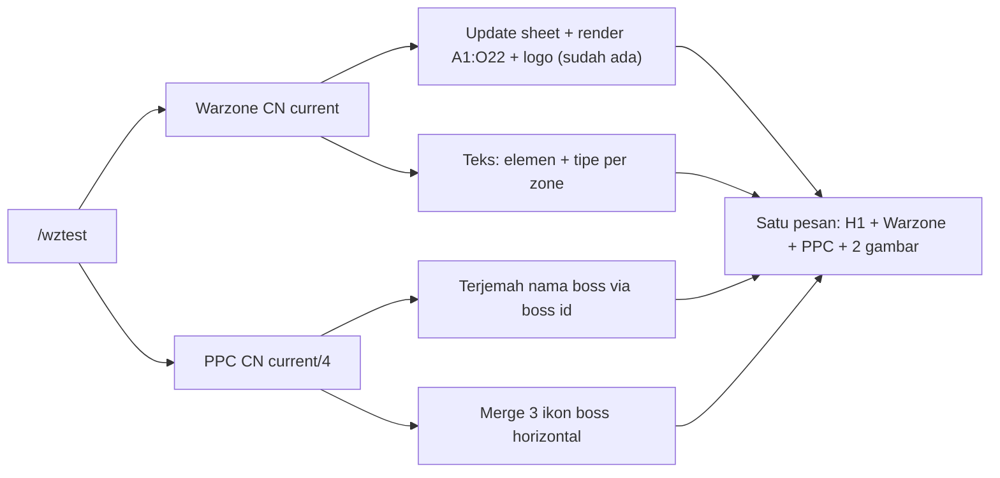

# PRD: Warzone & PPC Prediction (Text + 2 Images) via `/wztest`

| | |
|---|---|
| **Status** | Draft v1 |
| **Builds on** | [PRD-warzone-sheet-update.md](PRD-warzone-sheet-update.md), [PRD-warzone-predict.md](PRD-warzone-predict.md) |
| **Server** | CN (hardcode) |
| **Language** | English |

---

## 1. Goal

Mengubah output `/wztest` dari **embed** menjadi **satu pesan berisi teks ringkas + 2 gambar**:

1. Gambar 1: tabel Warzone (`A1:O22` dari sheet, seperti sekarang).
2. Gambar 2: gabungan horizontal ikon 3 boss PPC Ultimate CN.

Command **tanpa parameter**: selalu mengambil data **current** dari API Warzone CN dan PPC CN.

### Format pesan akhir

```
# Warzone & PPC Prediction Cycle 26 Oct 2026 ~ 01 Nov 2026
Warzone:
- Physical (Mob)
- Fire (Duo)
- Dark/Ignition (Duo)

PPC:
- Shorthalt
- Ephialtes
- Overseer
```
(+ lampiran: `warzone.png`, lalu `ppc.png`, dalam urutan itu.)

Contoh di atas dihitung dari data CN saat ini (Warzone activity 594, PPC activity 361).

---

## 2. Masalah yang diperbaiki: pesan error generik

Saat ini `/wztest` kadang membalas `Ada yang gagal diproses. Coba cek lagi perintahnya atau buka /help.` Pesan itu berasal dari blok `except Exception` di command, yang menyembunyikan penyebab asli.

**Hasil investigasi:** alur update sheet + render untuk `current` dan `590` saya jalankan langsung di luar Discord dan berhasil (gambar 151 KB). Jadi penyebab sebenarnya tidak terlihat dari sisi backend dan perlu dilihat dari log terminal bot (`wztest error: <Tipe>: <pesan>`). Karena itu perbaikan di PRD ini bersifat diagnostik **dan** pencegahan:

- **FR-0a:** log error lengkap (`traceback`) ke terminal dan ke `LOG_CHANNEL`, bukan satu baris saja.
- **FR-0b:** balasan ke user dibedakan per tahap: *gagal ambil data Warzone*, *gagal update sheet*, *gagal render sheet*, *gagal ambil PPC*, *gagal membuat gambar PPC*.
- **FR-0c:** `sys.stdout.reconfigure(encoding="utf-8")` saat startup. Terminal Windows memakai `cp1252`, sehingga `print` teks Mandarin (nama boss, zone) melempar `UnicodeEncodeError` (terjadi saat saya mengetes nama boss CN). Kode lama juga masih punya `print(current_wz)` pada command `wz`.

---

## 3. Functional Requirements

### FR-1 Command `/wztest` tanpa parameter
- Hapus parameter `activity`. Selalu memakai `current`.
- Tetap lewat `server_permission`. (Admin-only belum diwajibkan di versi sekarang; lihat Open Questions.)
- Tetap dibungkus `asyncio.Lock` karena menulis ke sheet bersama.

### FR-2 Pesan: teks langsung + gambar langsung
- Kirim **satu** `ctx.send(content=..., files=[warzone.png, ppc.png])`. Tidak ada `Embed`.
- Judul memakai heading level 1 Markdown (`# ...`).
- Tanggal `{Senin} ~ {Minggu}` dihitung dari cycle **Warzone** (WIB), format `DD Mon YYYY` (sama seperti sebelumnya).

> **Catatan bug laten:** `format_cycle_dates_wib` memakai tanggal `end` bila lebih besar dari Minggu. Cycle PPC berakhir Senin 04:00 WIB (`2026-11-01T21:00Z`), jadi bila dipakai untuk PPC, Minggu akan salah menjadi tanggal Senin. Judul harus selalu memakai tanggal Warzone, bukan PPC.

### FR-3 Baris teks Warzone: `- {elemen} (tipe)`

Satu baris per zone, urutan sama dengan response (zone 1, 2, 3).
- Zone dengan **1 buff** → `- {elemen} ({tipe})`.
- Zone dengan **2 buff** (Entropic Distortion) → `- {elemen1}/{elemen2} ({tipe})`, urutan mengikuti `buffs[0]`, `buffs[1]`.

**Mapping elemen** (key = **buff ID**, bukan nama, karena nama buff pernah berubah antar versi, mis. ID 4003 `Loop of Fire` vs `Cycle of Fire`):

| Buff ID | Nama buff | Elemen |
|---|---|---|
| 4001 | Machine Factory | Physical |
| 4003 | Cycle of Fire | Fire |
| 4004 | Laser Alloy | Lightning |
| 4005 | Shadow Forest | Dark |
| 4002 | Crimson Frostland | Ice |
| 4132 | Nihil Floating Platform | Nihil |
| 4161 | Molten Chasm | Ignition |
| 4115 | Shattered Peak | True Slash |
| 4175 | Shadowed Rift | Darkflow |
| 4088 | Diffraction Void | Distrupt |
| 4143 | Gelid Tower | Glacio |
| 4114 | Vortex Barrier | Plasma |

Disimpan di `data/wz_element_map.json` (juga menyimpan nama sebagai cadangan lookup). Buff ID tak dikenal → tampilkan nama buff apa adanya dan catat ke log.

**Mapping tipe** (key = **awalan sebelum tanda `:`** pada `zone.description`, tidak peduli huruf besar/kecil):

| Awalan | Tipe |
|---|---|
| `Duo Challenge` | Duo |
| `Desperate Fight` | Boss |
| `Joint Operation` | Mob |
| `Number Advantage` | Mob |
| `Crowd Battle` | Mob |

Alasan memakai awalan: deskripsi lengkap punya variasi teks untuk tipe yang sama, mis. `Desperate Fight: Only 1 enemy spawns per wave.` dan `Desperate Fight: Refresh only 1 enemy per wave`, serta `Duo Challenge: Only 2 Elite enemies spawn per wave` dan `Duo Challenge: Refresh 2 Elite enemies per wave`. Kecocokan penuh akan melewatkan salah satunya.

- Tipe tak dikenal → `(Unknown)` dan log peringatan.
- Zone yang tidak ada di dataset (deskripsi masih Mandarin): fallback awalan Mandarin, mis. `合军聚众`→Mob, `祸不单行`→Duo (kedua ini sudah terlihat di API). Awalan Mandarin untuk Boss/Crowd/Number Advantage harus diverifikasi dari data CN saat implementasi.

### FR-4 PPC: data
- `GET cn/ppc/current/4` (Ultimate). Gunakan `ppc_service.get_current_ppc_bosses("cn", "ultimate")` yang sudah ada; method itu sudah menghasilkan `name` dan `imgUrl`.
- Response CN berisi 3 boss pada `data.ppc.bosses` (saat ini: id `2030`, `2038`, `2040`).

### FR-5 PPC: terjemahan nama boss
Nama boss dari CN berbahasa Mandarin (`修特罗尔`, `埃比阿提斯`, `监管者`). Pencocokan **berdasarkan boss `id`** ke data AP:

| CN id | CN | English (dari AP) |
|---|---|---|
| 2030 | 修特罗尔 | Shorthalt |
| 2038 | 埃比阿提斯 | Ephialtes |
| 2040 | 监管者 | Overseer |

Bukti: id dan ikon identik di AP (`bosssingletab42/50/52`), dan ketiganya muncul di riwayat PPC AP.

- Bangun `data/ppc_boss_map.json` (`boss id → English name`) dengan script `scrape_ppc_bosses.py` yang memindai seluruh riwayat PPC AP (activity 143 s.d. 277, tipe `4`), pola yang sama dengan `scrape_zones.py`.
- Boss yang belum ada di map (boss baru yang baru rilis di CN) → tampilkan nama Mandarin apa adanya dan catat ke log.
- Nama English di sheet `ppc_boss` memakai slug yang sama dengan AP (`shorthalt`, `ephialtes`, `overseer`), jadi data itu bisa dipakai sebagai cadangan.

### FR-6 PPC: gambar gabungan
- Ambil `icon` ketiga boss (`image/uifubenbosssingle/bosssingletab42`, ...), URL = `https://assets.huaxu.app/glb/{icon}.webp` (sudah diverifikasi: ketiganya HTTP 200).
- Gabungkan **horizontal** dengan `merge_images_horizontal` di `utils.py`, urutan sama dengan urutan boss pada response. Ini fungsi yang sama dengan command `ppc`.
- **Hardening** (fungsi sekarang mengabaikan gambar yang gagal diunduh secara diam-diam, dan error bila semuanya gagal):
  - Bila ada gambar gagal diunduh → hentikan dan laporkan error PPC, jangan kirim gambar dengan jumlah boss kurang tanpa keterangan.
- Ekspor PNG, nama file `ppc.png`.

### FR-7 Degradasi bertahap (partial failure)
- Warzone berhasil, PPC gagal → tetap kirim bagian Warzone (teks + `warzone.png`), tambahkan baris `PPC: data unavailable` dan kirim detail error ke log channel.
- Warzone gagal → tidak ada pesan setengah jadi; balas error spesifik (FR-0b).

### FR-8 Konfigurasi
Tidak ada env var wajib baru. File data baru: `data/wz_element_map.json`, `data/ppc_boss_map.json`.

---

## 4. Perubahan kode (ringkas)

| File | Perubahan |
|---|---|
| `bot.py` | `/wztest` tanpa parameter, kirim `content` + 2 file (bukan embed), logging traceback, `stdout` UTF-8. |
| `services/warzone_service.py` | Method baru yang menghasilkan baris `elemen (tipe)` per zone dari data yang sudah ada (`get_cn_warzone_sheet_data`). |
| `services/ppc_service.py` | Method baru: boss CN current Ultimate + nama English (via `ppc_boss_map.json`). |
| `services/wz_sheet_service.py` | Orkestrasi: Warzone (sheet + render) dan PPC (merge gambar) dijalankan, hasilnya digabung dalam satu objek. |
| `utils.py` | Hardening `merge_images_horizontal`; helper susun teks pesan. |
| `data/wz_element_map.json` (baru) | Buff ID → elemen. |
| `data/ppc_boss_map.json` (baru) | Boss ID → nama English. |
| `scrape_ppc_bosses.py` (baru) | Membangun `ppc_boss_map.json` dari riwayat AP. |



---

## 5. Acceptance Criteria

1. `/wztest` tanpa argumen mengirim **satu pesan** tanpa embed: heading H1, blok `Warzone:`, blok `PPC:`, dan 2 lampiran gambar (Warzone dulu, lalu PPC).
2. Tiap baris Warzone sesuai format `- {elemen} (tipe)`; zone 3 dengan 2 buff tampil `{elemen1}/{elemen2}`. Contoh data saat ini: `Physical (Mob)`, `Fire (Duo)`, `Dark/Ignition (Duo)`.
3. Semua 12 buff ID dan 5 awalan tipe menghasilkan nilai sesuai tabel pada FR-3.
4. Baris PPC memuat 3 nama boss berbahasa Inggris (saat ini Shorthalt, Ephialtes, Overseer), urutan sama dengan gambar dari kiri ke kanan.
5. Gambar PPC berisi tepat 3 ikon boss, tersusun horizontal.
6. Tanggal judul = Senin ~ Minggu cycle Warzone dalam WIB.
7. PPC gagal → Warzone tetap terkirim dengan keterangan PPC tidak tersedia. Warzone gagal → pesan error spesifik, bukan teks generik.
8. Setiap error tercatat dengan traceback di terminal dan `LOG_CHANNEL`.
9. Menjalankan `/wztest` saat data CN memuat teks Mandarin tidak membuat bot crash karena encoding.
10. Command `/team`, `/ppc`, `/wz` tetap bekerja seperti sebelumnya.

---

## 6. Risiko

| Risiko | Dampak | Mitigasi |
|---|---|---|
| Boss baru di CN belum pernah muncul di AP | Nama boss tampil Mandarin | Fallback nama CN + log; jalankan ulang `scrape_ppc_bosses.py`. |
| Buff ID baru (elemen baru) | Elemen tampil sebagai nama buff | Fallback nama buff + log; tambah ke `wz_element_map.json`. |
| Awalan tipe baru atau awalan Mandarin belum terdata | `(Unknown)` | Log peringatan; tambah mapping. |
| `assets.huaxu.app` lambat/gagal | Gambar PPC tidak ada | Degradasi bertahap (FR-7). |
| Alur Warzone + PPC lebih lama dari 3 detik | Interaksi Discord kedaluwarsa | `defer` sudah dipakai; PPC diambil paralel dengan Warzone untuk memperpendek waktu. |
| Penyebab error generik asli belum teridentifikasi | Error bisa muncul lagi | FR-0a/0b memastikan penyebab langsung terlihat pada kejadian berikutnya. |

---

## 7. Open Questions

1. **Scheduler 14:15 WIB** (`warzone_predict_task`) saat ini masih mengirim embed teks lama. Apakah ikut diganti ke format baru ini, atau dibiarkan dulu sampai uji coba `/wztest` selesai? **Default PRD ini: hanya `/wztest` yang berubah.**
2. Ejaan `Distrupt` pada mapping elemen: dipakai persis seperti tertulis, atau dikoreksi menjadi `Disrupt`? **Default: persis seperti tertulis.**
3. Apakah `/wztest` sebaiknya dibatasi untuk admin saja (command ini menulis ke sheet bersama)? **Default: tidak dibatasi.**
4. Untuk PPC hanya Ultimate (`current/4`), atau Advanced juga? **Default: hanya Ultimate.**

---

## 8. Out of scope

- Penjadwalan otomatis memakai format baru (tahap berikutnya setelah `/wztest` stabil).
- Server selain CN.
- Teks/gambar untuk PPC Advanced.
